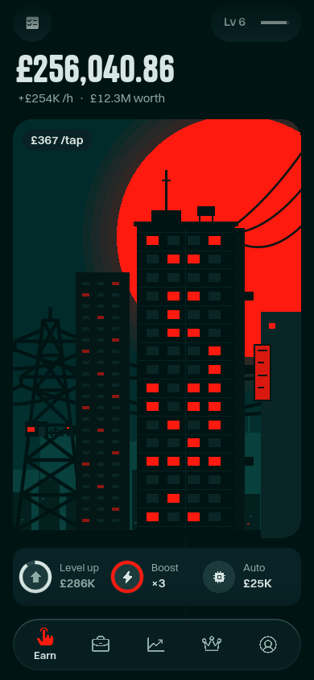
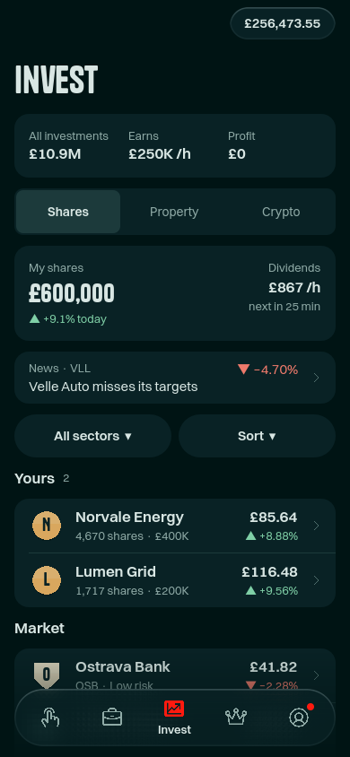
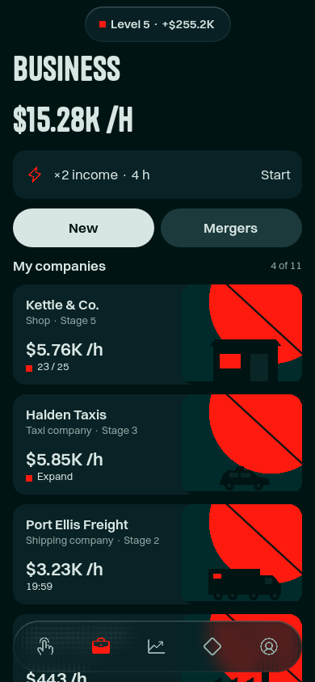
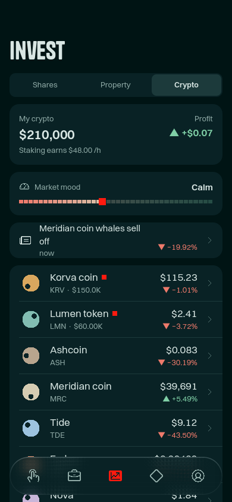
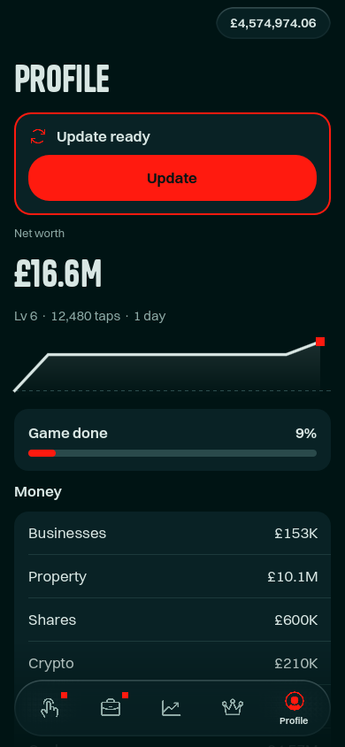

# Sol

A personal idle tycoon game for Android, made for one phone.
Tap to earn, start companies, trade made-up shares and well-known crypto coins, buy property and build a holding company.

  
  
  

  
  
  

## Please read

This is a personal project, not a product. There is no support, and no promise it works on your phone.

If you install it, you do so at your own risk (see [LICENSE](LICENSE)).

It's only a game. There's no real money, no real shares and no real crypto. Companies and places are made up. Coin names are used only to describe them; the game is not linked to or endorsed by any of them, and the prices are a simulation, not real market data. Nothing here is financial advice. No ads, no payments, no accounts.

## Privacy

- Your progress is saved only on your phone.
- The app collects nothing and sends nothing about you.
- Its only network use is checking this repository's public releases for updates and downloading them.
- The "problem report" stays on your phone unless you choose to paste it somewhere.

## Built with

- [Godot Engine](https://godotengine.org) 4.4 (MIT)
- [Switzer](https://www.fontshare.com/fonts/switzer) and [Tanker](https://www.fontshare.com/fonts/tanker) fonts from Fontshare (ITF Free Font License). They aren't stored here: the build downloads them from Fontshare.
- [Inter](https://github.com/rsms/inter) font as a backup (SIL Open Font License 1.1), see `game/assets/fonts/LICENSE.txt`
- [Phosphor](https://github.com/phosphor-icons/core) icons (MIT), see `game/assets/icons/LICENSE-phosphor.txt`

## For developers

Start with [CLAUDE.md](CLAUDE.md). Then:
[design](docs/DESIGN.md), [balance](docs/BALANCE.md), [testing](docs/TESTING.md), [architecture](docs/ARCHITECTURE.md).
`python3 tools/check_rules.py` checks the project rules; CI runs it on every push.

## Licence

Copyright (c) 2026 the repository owner. All rights reserved.
You may look at the code here, but you may not copy, change, share or sell it, or any part of it, without written permission.
Third-party parts keep their own licences (listed above).
