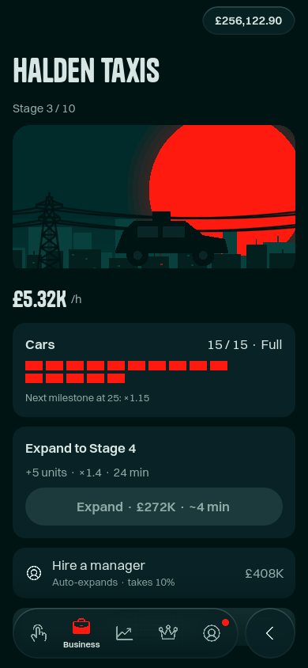
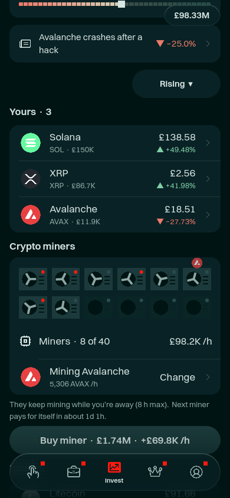
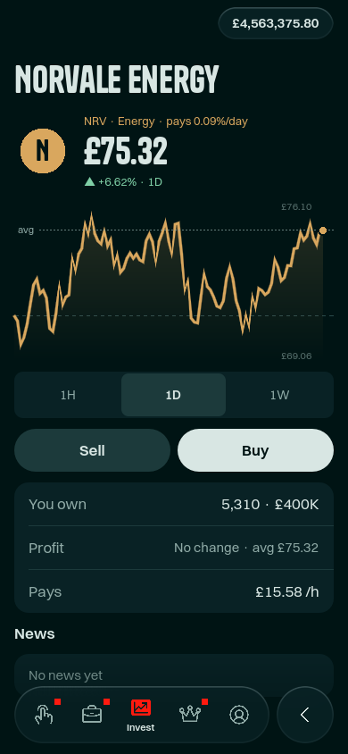

# Sol

A personal idle tycoon game for Android, made for one phone.
Tap to earn, start companies, trade made-up shares and well-known crypto coins, buy property and build a holding company.

  
  
  

  
  
  

## What's in it

- 17 companies to open, fill and expand, with milestones, partners and head office upgrades
- Shares, property and real crypto coins (with miners and locking)
- Daily and weekly goals, golden suns, rivals, achievements
- Rebirth for RBP and a 158-node tree that stays forever, with unlocks for new content
- A casino (unlocked in the tree): slots, roulette and blackjack, play money only
- Built to take weeks, not days

Latest changes: [CHANGELOG.md](CHANGELOG.md).

## Please read

**This game is made for me, on my phone. It is not for anyone else.**

- It was built mostly with AI help ("vibe coded") and has not been checked by security or safety experts. It may have bugs or lose data.
- If you install or use it, that's entirely at your own risk. I take no responsibility for anything that happens. See [LICENSE](LICENSE).
- There is no support and no promise it works on your phone.

It's only a game. There's no real money, no real shares and no real crypto. Companies and places are made up. Coin names are used only to describe them; the game is not linked to or endorsed by any of them, and the prices are a simulation, not real market data. Nothing here is financial advice. No ads, no payments, no accounts.

## Is it safe?

You can check for yourself:
- **Built in public.** Every `Sol.apk` is built by GitHub Actions from the code here, never on someone's own computer. Each release links to its build log.
- **Proof of origin.** Each APK carries a signed GitHub stamp. Check it with `gh attestation verify Sol.apk -R ytjustjosh17-cpu/MCG`.
- **Fingerprint.** Each release lists the file's SHA-256. If yours matches, it hasn't been changed.
- **Virus scan.** Each release links to VirusTotal for that exact file.

Permissions the app asks for:

| Permission | Why |
|---|---|
| Internet | Checks this repo's releases for updates. Nothing else. |
| Vibrate | Small taps of feedback; can be turned off in Settings. |
| Install apps | Only for the Update button, which installs a new `Sol.apk` from this repo's releases. |

Android may warn about any app not from the Play Store. That's normal for apps you install yourself.
Only install `Sol.apk` from this repo's Releases page.

## Privacy

- Your progress is saved only on your phone.
- The app collects nothing and sends nothing about you.
- Its only network use is checking this repository's public releases for updates and downloading them.
- The "problem report" stays on your phone unless you choose to paste it somewhere.

## Built with

- [Godot Engine](https://godotengine.org) 4.4 (MIT)
- [Switzer](https://www.fontshare.com/fonts/switzer) and [Tanker](https://www.fontshare.com/fonts/tanker) fonts from Fontshare (ITF Free Font License). They aren't stored here: the build downloads them from Fontshare.
- [Inter](https://github.com/rsms/inter) font as a backup (SIL Open Font License 1.1), see `game/assets/fonts/LICENSE.txt`
- [Phosphor](https://github.com/phosphor-icons/core) icons (MIT), see `game/assets/icons/LICENSE-phosphor.txt`
- Coin logos from [cryptocurrency-icons](https://github.com/spothq/cryptocurrency-icons) (CC0), see `game/assets/coins/LICENSE.txt`
- Playing cards from Kenney's Boardgame Pack (CC0), see `game/assets/cards/LICENSE-kenney.txt`

## For developers

Start with [CLAUDE.md](CLAUDE.md). Then:
[design](docs/DESIGN.md), [balance](docs/BALANCE.md), [testing](docs/TESTING.md), [architecture](docs/ARCHITECTURE.md).
`python3 tools/check_rules.py` checks the project rules; CI runs it on every push.

## Licence

Copyright (c) 2026 the repository owner. All rights reserved.
You may look at the code here, but you may not copy, change, share or sell it, or any part of it, without written permission.
Third-party parts keep their own licences (listed above).
